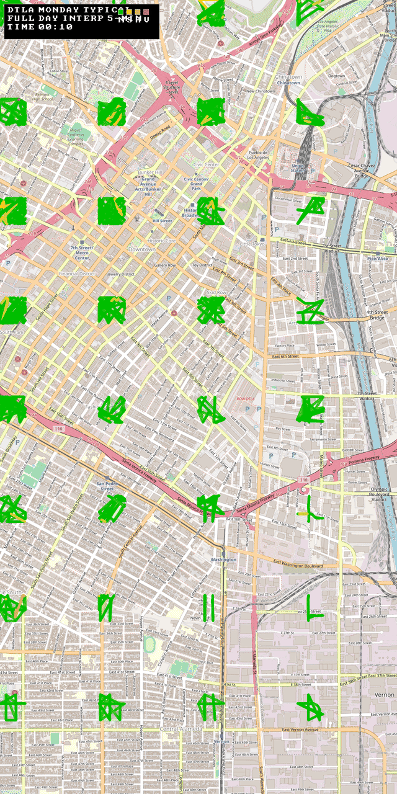

# google_maps_traffic

Rust library for fetching and decoding Google Maps traffic vector tiles, with optional OSM edge matching and speed estimation.

## DTLA full-day timelapse



Generated from OSM basemap + decoded Google typical traffic data for Monday across 24h.

## What it does

- Fetches **live traffic** tiles from Google Maps and decodes:
  - road geometry
  - per-segment congestion levels
  - traffic incidents
- Fetches **typical (historical)** traffic by day-of-week and hour.
- Optionally (`osm` feature) loads OSM `.pbf` road networks, matches traffic segments to OSM edges, and estimates practical travel speed from:
  - legal speed limit (`maxspeed` / defaults)
  - congestion class
  - hour-of-day factors
  - matched travel direction (forward/reverse)

## Highlights

- Tile math helpers for Web Mercator XYZ (`zoom 0..=21`).
- Robust bounds handling including antimeridian crossing.
- Retry logic for transient HTTP failures.
- OSM loading with oneway + directional speed handling.
- Direction-aware OSM matching preserves both directions on two-way roads.
- Fuzzing targets and smoke scripts for parser/matcher hardening.

## Install

`Cargo.toml`:

```toml
[dependencies]
google_maps_traffic = { git = "https://github.com/irdbl/google_maps_traffic" }
# For OSM matching:
# google_maps_traffic = { git = "https://github.com/irdbl/google_maps_traffic", features = ["osm"] }
```

This crate is async and intended for `tokio` runtimes.

## Quick start (live traffic)

```rust
use google_maps_traffic::{Bounds, TileCoord, TrafficClient};

#[tokio::main]
async fn main() -> Result<(), Box<dyn std::error::Error>> {
    let client = TrafficClient::new()?;

    let coord = TileCoord::new(12, 1205, 1540)?;
    let tile = client.get_tile(coord).await?;
    println!("features={} incidents={}", tile.features.len(), tile.incidents.len());

    let bounds = Bounds::new(40.748, -73.995, 40.758, -73.975);
    let tiles = client.get_traffic(&bounds, 14).await?;
    println!("tiles={}", tiles.len());

    Ok(())
}
```

## Typical traffic (day/hour)

```rust
use google_maps_traffic::{Bounds, DayOfWeek, TrafficClient};

#[tokio::main]
async fn main() -> Result<(), Box<dyn std::error::Error>> {
    let client = TrafficClient::new()?;
    let bounds = Bounds::new(33.999, -118.265, 34.065, -118.225);

    let mon_8am = client
        .get_typical_traffic(&bounds, 14, DayOfWeek::Monday, 8)
        .await?;

    println!("typical tiles={}", mon_8am.len());
    Ok(())
}
```

## OSM matching and speed estimation (`osm` feature)

```rust
use google_maps_traffic::{
    Bounds, MatchConfig, OsmRoadNetwork, SpeedEstimationConfig, TrafficClient,
};

#[tokio::main]
async fn main() -> Result<(), Box<dyn std::error::Error>> {
    let pbf_path = "./region.osm.pbf";
    let bounds = Bounds::new(33.999, -118.265, 34.065, -118.225);
    let zoom = 14;

    let network = OsmRoadNetwork::from_pbf_for_traffic_bounds(pbf_path, &bounds, zoom)?;
    let client = TrafficClient::new()?;
    let tiles = client.get_traffic(&bounds, zoom).await?;

    let match_cfg = MatchConfig::for_zoom(zoom);
    let out = network.match_tiles(&tiles, &match_cfg);

    let speed_cfg = SpeedEstimationConfig::default();
    for m in out.matches.iter().take(5) {
        let est_kph = m
            .estimate_speed_in_match_direction_kph(Some(17), &speed_cfg)
            .unwrap_or_else(|| m.estimate_speed_kph(Some(17), &speed_cfg));
        println!(
            "way={} dir={:?} limit={:.1} est={:.1}",
            m.edge.way_id,
            m.direction,
            m.edge.max_speed_kph,
            est_kph
        );
    }

    Ok(())
}
```

## Included examples

- `cargo run --example traffic`
- `cargo run --example typical_vs_live`
- `cargo run --example la_scan`
- `cargo run --example direction_check`
- `cargo run --release --example dtla_osm_timelapse_gif`
- `cargo run --release --example dtla_live_snapshot_png -- artifacts/visual_smoke/dtla_live_snapshot.png`
- `TYPICAL_HOUR=9 cargo run --release --example dtla_live_snapshot_png -- artifacts/visual_smoke/dtla_typical_snapshot_09.png`
- `cargo run --example osm_match --features osm -- <path/to.osm.pbf>`
- `cargo run --example osm_zoom_benchmark --features osm -- <path/to.osm.pbf>`
- `cargo run --example osm_stress --features osm -- <path/to.osm.pbf>`

`dtla_osm_timelapse_gif` writes `artifacts/dtla_osm_typical_monday_full_day_z15_5min.gif` by default (full-day loop, 5-minute interpolation, zoom 15).  
The repository includes a push-safe preview at `docs/assets/dtla_osm_typical_monday_full_day_z15_5min_preview.gif`.
The render uses flow-offset strokes + arrowheads so segment direction is visible.

## Quality and hardening

CI workflow runs:

- `cargo fmt --all -- --check`
- `cargo clippy --features osm --all-targets -- -D warnings`
- `cargo test --features osm --all-targets`
- fuzz smoke (`SMOKE_TIME=8 ./fuzz/scripts/run_smoke.sh`)

Local fuzz docs/scripts:

- [fuzz/README.md](fuzz/README.md)
- `./fuzz/scripts/run_smoke.sh`
- `./fuzz/scripts/update_osm_matcher_smoke_corpus.sh`

Branch protection helper:

- [docs/branch_protection.md](docs/branch_protection.md)
- `./scripts/configure_branch_protection.sh`

## Notes and caveats

- This project is currently tuned for research/engineering workflows, not guaranteed production SLAs.
- Endpoints and payload formats are external and may change.
- Be mindful of applicable terms of service and local legal constraints when collecting or using traffic data.
